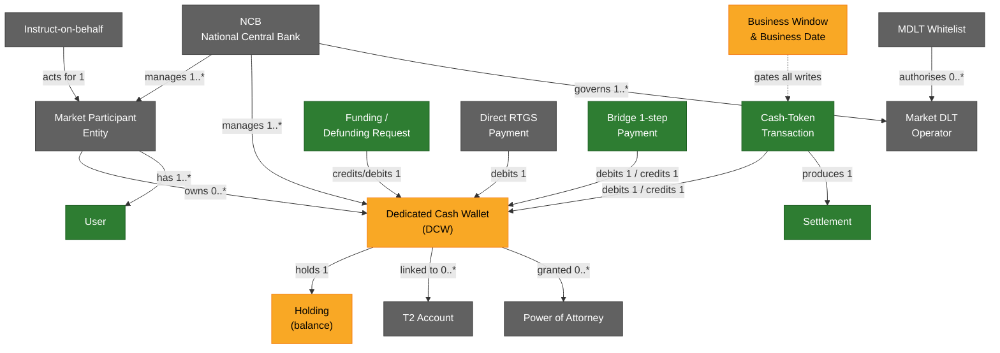
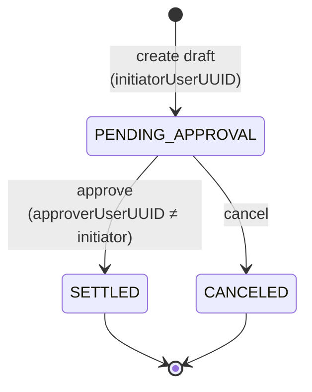
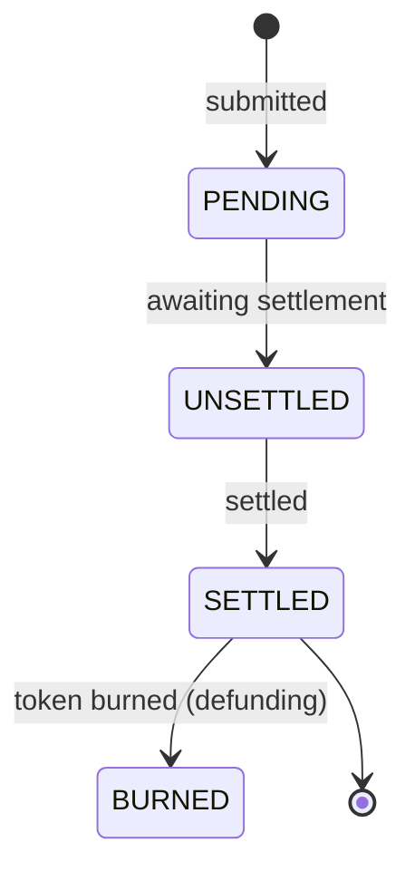
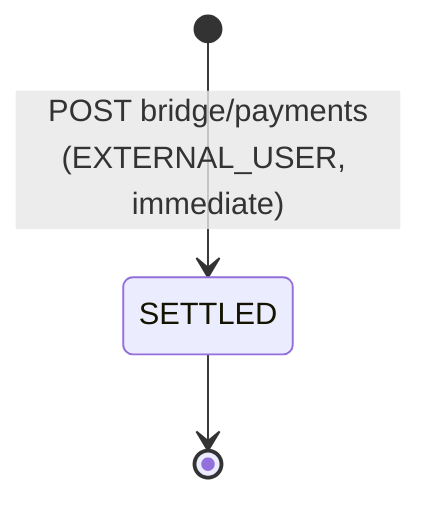
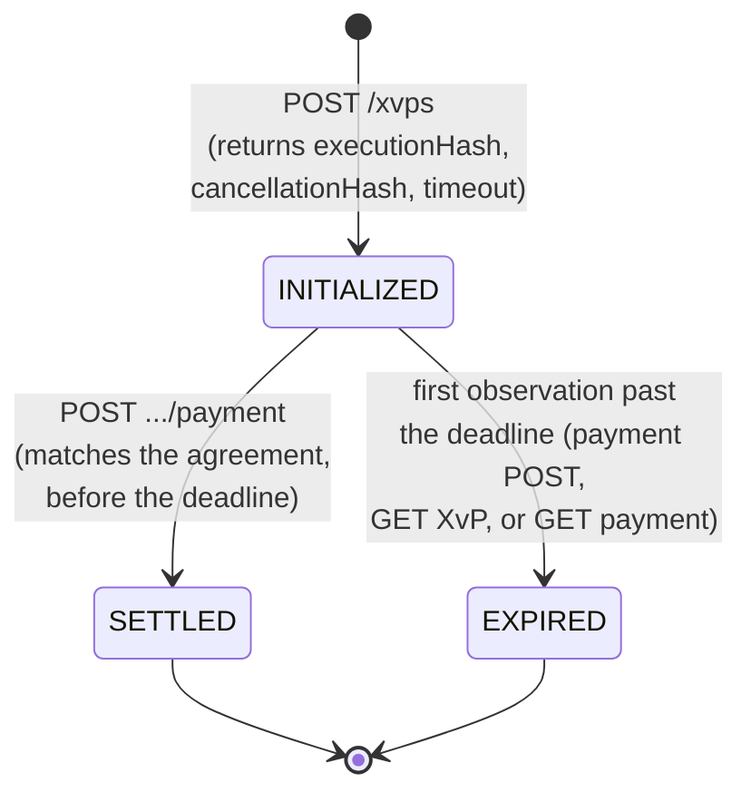

# Pontes domain model (objects, cardinalities & lifecycles)

A functional map of the concepts the ECB Pontes A2A API manipulates — the
business objects, how they relate (cardinalities), their key fields, and how
their state changes — plus **which concepts this mock implements today**.

> Scope: this is a **functional** model. Security/transport layers (mTLS, OAuth2
> JWT, NRO signing) are intentionally **excluded** — except the **User** concept,
> which is a first-class functional object. For the security layers see
> [`TLS-MTLS-AND-CERTS.md`](TLS-MTLS-AND-CERTS.md). For endpoint-by-endpoint
> coverage see [`ENDPOINT-COVERAGE.md`](ENDPOINT-COVERAGE.md).
>
> Source: the vendored official spec `src/ui/spec/pontes-official-v1.0.json`
> (EII API v1.0.0).

## Legend

| Colour | Meaning |
|--------|---------|
| 🟢 **Implemented** | the mock exposes and drives this concept |
| 🟡 **Partial** | present but simplified (e.g. read-only, auto-created, not enforced) |
| ⚪ **Not implemented** | defined by the official API, not in the mock yet |

---

## 1. Concept map

---

## 2. Concepts

### 2.1 NCB (National Central Bank) ⚪

The managing central bank / realm. Every object is scoped to an NCB (the `{ncb}`
path segment and the OAuth realm). Referenced by `managerID` / `managerNCB` on
wallets and entities.

- Key fields: `bic`, `name`, `country`.
- Cardinality: **1 NCB → many** Entities, DCWs, Market DLT Operators.
- Official endpoints: `GET .../grs/ncbs`, `.../grs/ncbs/{id}`. **Not implemented**
  (the mock hard-codes the NCB from the realm).

### 2.2 Market Participant Entity 🟡

A participant in the ESY DLT (a bank/PSP), identified by BIC.

- **Create** (`globalregistry.CreateEntity`, 2-step): `entityID`, `entityIDType`
  (`BIC`), `name`, `shortName`, `countryCode`, `rolesTable`, `validFrom`/`validTo`.
- **Read** (`globalregistry.Entity`) adds: `id`, `mspID`, `domain`, `isBlocked`,
  `isPrivate`, `status`, `fourEyesType`, `instructingPartyID`, `initiatorUserUUID`,
  `historicStatus`, `timestamps`, `lastUpdated`.
- Blocking is toggled via `PATCH .../grs/entities/{id}` (`isBlocked`).
- Cardinality: owns **0..\*** DCWs; groups **1..\*** Users.
- Official endpoints: `grs/entities` (create 2-step, list, get, patch blocking).
  **List + get are implemented**, served verbatim from a static HAR-captured
  fixture (`src/data/grs-entities.json`, 113 records — both settled and
  in-flight draft entities); lookup by `{entityid}` matches either the settled
  `entityID` (BIC) or a draft-only `id`. **Create/patch/draft-transition remain
  not implemented** — the mock still infers the owning entity from the wallet
  alias / enrolled user's `entityBIC` elsewhere.
- States: `PENDING_APPROVAL` → `ACTIVE` (approve) / `CANCELED` (cancel); then
  `ACTIVE` ⇄ `BLOCKED` via patch.

### 2.3 User 🟢

A named human/service identity that authenticates and initiates/approves
operations. **The only security-adjacent object included here.**

- Key fields: `username`, `entity`/`externalEntity`, `roles`, `email`, `enabled`,
  `networkID`, plus (mock) `profile` (`PILOT_READ_WRITE`, `EXTERNAL_USER`, …) and
  `entityBIC`.
- Cardinality: belongs to **1** Entity; a 2-step operation involves **2 distinct**
  Users (`initiatorUserUUID` ≠ `approverUserUUID`).
- Mock: declared + certificate-enrolled via the IAM/Keycloak endpoints
  (`.../openid-connect/token`, `/csr`, `/certs`, `admin/enrolled-users`).
- Tokens (issue #64): the password grant returns an ES256 `access_token`
  (`expires_in` 300s) **and** a `refresh_token` (`refresh_expires_in` 864000s =
  10 days), Keycloak-style. The token endpoint also accepts
  `grant_type=refresh_token` to mint a fresh pair; a refresh token cannot be used
  as a bearer access token (`typ: "Refresh"` is rejected by the JWT middleware).

### 2.4 Dedicated Cash Wallet (DCW) 🟡

The cash-token account holding a balance.

- Key fields: `walletAlias`, `ownerEntityID`, `managerID` (NCB), `isMainWallet`,
  `status`, `fourEyesType`, `validFrom`/`validTo`, `holdingTable`,
  `t2AccountWalletLinks`, `POAs`.
- Cardinality: owned by **1** Entity, managed by **1** NCB; holds **1** Holding
  per currency; linked to **0..\*** T2 Accounts.
- Official: create (2-step), list, get, get settled transactions, total-under-mgmt.
- Mock: **read** (`GET .../ams/wallets`, `.../{walias}`, `.../transactions`) and
  **one-step create** (`POST .../ams/wallets/one-step`, mock-only) implemented.
  The official `POST .../ams/wallets` creates a wallet *draft* a second user must
  validate (four-eyes) and is **not implemented** (returns `501`); the one-step
  variant creates the DCW immediately. Creation is scoped to the caller's **own
  entity** — the owner is taken from the verified JWT, never the request body
  (issue #77). Auto-creation is now **funding-only**: funding
  creates the credited wallet for the caller's entity if it doesn't exist (issue
  #23/#77); **every other settlement path rejects an unknown credited wallet**
  with `422 HL-WAL-003` rather than silently discarding the credit (which
  destroyed cash — conservation of value, issue #77). A missing **debit-side**
  wallet still raises `422 HL-WAL-002`. As of #13 the DCW is properly modelled:
  **`availableBalance` +
  `lockedBalance`** (invariant available + locked = total), per-currency
  holdings, `isBlocked`/validity, and **debit rights** (only a user of the owning
  entity may debit by default; PoA grantees / whitelisted operators too). The
  store exposes `credit`/`debit`/`lock`/`release`/`settleLocked` + `canDebit`,
  persisted to **Redis when `REDIS_URL` is set**. Still missing: the official
  2-step **creation** flow and T2-link modelling.

### 2.5 Holding 🟡

A balance line inside a DCW.

- Key fields: `holdingID`, `walletAlias`, `amount`, `type`, `modalityType`.
- Cardinality: **1 DCW → 1..\*** Holdings (per currency/modality). The mock
  exposes an `AVAILABLE` and a `LOCKED` holding per wallet (EUR).

### 2.6 T2 Account ⚪

An RTGS (TARGET2) account reference a DCW is linked to for funding/defunding.

- **Create** (`accountmanagement.CreateT2Account`, 2-step): `accountReference`,
  `countryCode`, `links` (array of `T2AccountWalletLink`).
- **Read** (`accountmanagement.T2Account`) adds: `id`, `managerID`, `status`,
  `fourEyesType`, `instructingPartyID`, `initiatorUserUUID`, `historicStatus`,
  `timestamps`, `lastUpdated`.
- Cardinality: linked to **0..\*** DCWs via `T2AccountWalletLink`.
- States: `PENDING_APPROVAL` → `ACTIVE` / `CANCELED`.
- Official: create (2-step), list, get. **Not implemented** — funding treats the
  token-issuance wallet as an infinite source instead.

### 2.7 Power of Attorney (PoA) ⚪

Authorises a party to operate a DCW on behalf of the owner.

- Fields: `id`, grantor/authorised party, `status`, `fourEyesType`,
  `validFrom`/`validTo` (embedded in the wallet's `POAs` array).
- Cardinality: **0..\*** per DCW.
- States: `PENDING_APPROVAL` → `ACTIVE` / `CANCELED`.
- Official: `ams/poa-drafts` (create 2-step), `ams/poa/{id}`. **Not implemented.**

### 2.8 Cash-Token Transaction 🟢

A wallet-to-wallet cash-token transfer/payment (2-step).

- Key fields: `id` (the draft/transaction identifier, matching the official
  `*.Response` schemas), `amountTransferred`, `currency`
  (`EUR`), `creditedCashWalletAlias`, `debitedCashWalletAlias`,
  `creditedCashWalletManagerID`, `debitedCashWalletManagerID`, `type`,
  `cbdcRequestType`, `instructingPartyID`, `status`, and the undocumented
  `supplementaryData` ("reason of payment" — confirmed accepted, via direct
  correspondence with ECB support, on both the 1-step `bridge/payments` and
  2-step `rvs/transactions-requests` endpoints, though absent from the
  published spec).
- Cardinality: debits **1** DCW, credits **1** DCW; produces **1** Settlement.
- Mock: `POST .../rvs/transactions-requests` (draft) + `PUT .../transactions-drafts/{id}/approve|cancel`.
- **Id sourcing** (issue #32): a client-supplied instruction id is honoured where
  the official request schema carries one (RVS transfer `instructionID`,
  direct-RTGS `id`); otherwise the mock mints a deterministic **daily-sequence**
  id `{PREFIX}{yyMMdd}{seq:06}` (`TR`/`FRQ`/`DRQ`/`DRTGS`) — monotonic and
  collision-safe (no `Math.random`). A duplicate client id → `409 HL-GER-004`.

### 2.9 Settlement 🟢 (read) / octopus.Settlement

The settled record of a transaction / funding movement (the transactions query).

- Key fields: `settlementID`, `amount`, `currency`, `moveSource`/`moveDestination`
  (+ manager/owner), `moveDirection`, `moveType`, `settlementDate`/`settlementTime`,
  `operationContext` (`Cross`/`Intra`), `supplementaryData`.
- Mock: surfaced via `GET .../ims/transactions` (returns in-flight drafts rather
  than the full settled-extract model).

### 2.10 Funding / Defunding Request 🟢

Moves cash between a T2 account and a DCW (2-step, NRO-signed).

- Key fields: `techFundRequestID`, `amount`, `currency`, `type`,
  `creditedCashWalletAlias`/`ManagerID`/`OwnerID`,
  `debitedCashWalletAlias`/`ManagerID`/`OwnerID`, `signature`, `signerPEM`.
- Cardinality: credits (funding) or debits (defunding) **1** DCW.
- Mock: `POST .../tms/funding-requests` & `.../defunding-requests` (draft) +
  `.../{id}/approve` (funding also `cancel`; defunding approve-only). The
  token-issuance wallet is treated as an **infinite** source.

### 2.11 Direct RTGS Payment 🟡

A payment settling directly on RTGS (TARGET2), NRO-signed. Modelled in the mock
as a **composite** of a *defunding on the payer* + a *funding on the receiver*.

- Fields (`triggermanagement.DirectRTGSPaymentInstruction`): `id`,
  `correlationId`, `amount`, `currency`, `payerBank`, `receiverBank`,
  `signature`, `signerPEM`.
- NRO signing string: `id + amount + payerBank + receiverBank`.
- States: `PENDING_APPROVAL` → `SETTLED` / `CANCELED` (2-step) for the
  `tms/direct-rtgs/payments` variant; the `bridge/direct-rtgs/payments` variant
  is 1-step. **Implemented** as `DirectRtgsWorkflow` (checked debit of the payer
  + credit of the receiver): 2-step checks availability + debit rights at approval
  with four-eyes; 1-step checks immediately.

### 2.12 Bridge 1-step Payment 🟢 (cash-token) / 🟢 (PFoD) / 🟢 (XvP)

Immediate settlement, no draft/approve cycle.

- Key fields (`bridge.PaymentRequest`): `paymentID`, `amount`, `currency`,
  `creditedCashWalletAlias`/`ManagerID`, `debitedCashWalletAlias`/`ManagerID`.
- Mock: `POST .../bridge/payments` implemented (EXTERNAL_USER).
- **PFoD** (Payment-Free-of-Delivery) — **implemented** as two matched legs on
  `tradeID` (deliver=`bridge.PFoDDeliRequest`, receive=`bridge.PFoDReceRequest`);
  the matched wallet payment fires once both legs are present and consistent.
- **XvP** (`/igw/**`) — **implemented**; see §4 for the full protocol.

### 2.13 Market DLT Operator & Whitelist ⚪

Registry of DLT platform operators and their authorisation whitelist.

- `MarketDLTOperator`: `mdltOperatorID`, `operatorID`, `networkID`,
  `responsibleNCB`, `isBlocked`.
- `CreateMarketDLTOperatorWhitelist`: `managerID`, `marketDLTOperatorID`,
  `marketDLTPlatformID`, `participantID`, `validFrom`/`validTo`.
- Cardinality: a Whitelist authorises **0..\*** operators for a platform.
- States: `PENDING_APPROVAL` → `ACTIVE` / `CANCELED`; `ACTIVE` ⇄ `BLOCKED`.
  **Not implemented.**

### 2.14 Instruct-on-behalf ⚪

An operation an operator/authorised party instructs for another entity.

- Fields (`triggermanagement.CreateInstructOnBehalf`): `grantorParticipantBIC`,
  `authorizedParticipantBIC` (the AMS variant adds wallet context).
- States: `PENDING_APPROVAL` → `ACTIVE` / `CANCELED`.
- Official: `tms/instruct-on-behalf-drafts`, `ams/...`. **Not implemented.**

### 2.15 Business Window & Business Date �

The market calendar gating when operations may run.

- `BusinessDay` (mock store): `businessDate` + the four boundary times
  `sodStart` / `ofaStart` / `ofaEnd` / `eodEnd` that partition the Frankfurt day.
  The current window is **derived** from the Frankfurt-local time (never stored):
  `[sodStart, ofaStart)` → Start of Day, `[ofaStart, ofaEnd)` → Open for All,
  `[ofaEnd, eodEnd)` → End of Day, otherwise → Closed. Defaults keep the day
  Open-for-All almost all day (`00:00 / 00:01 / 23:58 / 23:59`).
- `BusinessWindow` (official read): `windowName` (Start of Day / Open for All /
  End of Day / Closed), `startTime`, `endTime`, `nextWindowName`.
- `BusinessWindow[]` (official read, `grs/business-windows`): the full daily
  cycle as an array — `windowID`, `nextWindowID`, `name`, `startTime`,
  `authorizedRoles`. Window IDs are stable mock UUIDs; `startTime`s are derived
  from the same stored day boundaries as the single-window endpoints, so the
  cycle never contradicts them.
- `BusinessDate`: `businessDate`, `updateBDStatus`
  (`FULL_UPDATE_ALLOWED` / `UPDATE_NOT_ALLOWED` / `CONDITIONAL_UPDATE_ALLOWED`).
- Mock: `GET .../bridge/current-business-window`, `.../grs/current-business-window`,
  `.../grs/businessdate`, `.../grs/business-windows` compute the window(s) from
  the stored day.
  `GET /admin/business-window` shows the day fields **plus** the live window +
  `isOpen`; `POST` (or `PUT`) `/admin/business-window` sets any sub-list of day
  fields (times must stay in increasing order).
- Enforcement (issues #59, #81, #94) is **always on** and **spec-driven**: each
  official operation is accessible only in the windows its spec description
  lists (e.g. bridge/XvP payments = Open for All only; transfer creation = Open
  for All only; most reads = Start of Day / Open for All / End of Day). A window
  entry qualified `(only for ISSUANCE)` / `(only for REDEMPTION)` is open only
  when the request is that specific central-bank operation; the mock does not
  model those request types, so such qualified windows are excluded — leaving an
  ordinary transfer accessible only in the unqualified **Open for all** window.
  Requests outside the allowed windows are rejected with `403 HL-BW-001`.
  `PONTES_MOCK_BUSINESS_WINDOW_ALWAYS_OPEN=true` disables enforcement (CI/demos).

---

## 3. Lifecycles (state changes)

### 3.1 The 2-step (4-eyes) draft lifecycle

Every create operation on Wallets, T2 Accounts, Entities, Transactions,
Funding/Defunding, Direct RTGS, mDLT Operators/Whitelists, PoA and
Instruct-on-behalf follows the same shape — the `{status}` path segment is always
`approve` or `cancel`, and the approver must differ from the initiator.

In the mock this is implemented for **transactions** and **funding/defunding**
(🟢); the same lifecycle for **entities, wallets, T2 accounts, PoA, mDLT** is ⚪
not implemented. Behaviour: `404` on unknown draft, `409` if not `PENDING_APPROVAL`.

**Generic Workflow engine.** All money-movement operations (2-step transfer,
funding, defunding, direct-RTGS, the 1-step bridge payment, matched PFoD and
XvP, §4) share a single `Workflow` base (`src/workflows/`) that implements exactly this
state machine plus two extension points: `conditions(phase)` (validate/authorise
a transition) and `apply()` (the DCW debit/credit effect at settlement). One-step
workflows collapse `create`+`approve` into a single `execute()`. Consistent with
the availability policy, **no workflow reserves funds up front** — a debit's
availability and debit **rights** are checked **only at the settling step**
(the approval step for two-step workflows; `pay()` for XvP) via the checked
DCW op, returning `403` for rights / `422` for insufficient funds, and
two-step workflows additionally enforce **four-eyes** (approver ≠ initiator).
Workflow records and settled transactions persist to Redis when `REDIS_URL`
is set.

### 3.2 Settlement / payment status

`PaymentStatus` enum on settled records:

The mock settles **immediately** on approval (drafts jump straight to `SETTLED`);
`UNSETTLED`/`BURNED` intermediate states are not modelled.

### 3.3 1-step bridge payment

---

## 4. XvP (Hash-Link) protocol 🟢 — implemented

**XvP** ("eXchange versus Payment") settles the **cash leg** on Pontes
alongside a **delivery/other leg** on a separate (market) DLT — i.e. **DvP**
(delivery-vs-payment) or **PvP** (payment-vs-payment). It is called a
"Hash-Link" protocol because `init()` issues two commitments — an
`executionHash` and a `cancellationHash` — that the *other* (market) leg is
built against; on this mock's cash leg itself, settlement is driven directly
by the buyer's `POST .../payment` matching the agreement (BICs/amount/
currency), **not** by that caller submitting a preimage — see the Flow and
"Implemented as `XvpWorkflow`" notes below for what actually happens.

Two variants live on the **IGW** (inbound gateway):

- **Cash-token XvP** — `/igw/{ncb}/v1/xvps` (seller settles from a cash-token DCW).
- **Direct-RTGS XvP** — `/igw/{ncb}/v1/direct-rtgs/xvps` (seller settles on RTGS).

### Participants & enums

| Type | Fields |
|------|--------|
| `SimpleParticipant` (buyer) | `bic` |
| `Participant` (cash-token seller) | `bic`, `cashWalletAlias`, `marketDLTOperator` |
| `RTGSParticipant` (RTGS seller) | `bic`, `marketDLTOperator` |
| `TransactionType` | `DVP` \| `PVP` |
| `KeyType` | `EXECUTION` \| `CANCELLATION` |
| `PaymentStatus` | `PENDING` \| `UNSETTLED` \| `SETTLED` \| `BURNED` |

### Objects & fields

| Object | Key fields |
|--------|-----------|
| `XvPInitRequest` | `seller`, `buyer`, `amount`, `currency` (`EUR`), `type` (DVP/PVP) |
| `XvPInitResponse` | `xvpTransactionId`, **`executionHash`**, **`cancellationHash`**, `timeout` (ISO ts), + echoed `seller`/`buyer`/`amount`/`currency`/`type` |
| `PaymentRequest` | `buyer` (`Participant`: `bic` + `marketDLTOperator` required, `cashWalletAlias` optional/nullable), `seller` (`SimpleParticipant`: `bic`), `amount`, `currency` (`EUR`) |
| `Payment` | `id`, `status` (`PaymentStatus`), `reason` |
| `PaymentResponse` | `xvpTransactionId`, `payment`, **`executionKey`**, **`cancellationKey`** |

> **Hash convention (issue #145, revising #141).** `executionKey`/
> `cancellationKey` are 32 random bytes, encoded on the wire as 64 lowercase
> hex characters. `executionHash`/`cancellationHash` are `SHA-256` of the
> corresponding key, under one of two configurable conventions
> (`XVP_HASH_METHOD`, see `.env.example`):
>
> - `hex-string` (**default**, unset or empty): `SHA-256` of the UTF-8 bytes
>   of the 64-character hex key *text itself* — the convention suggested by
>   the OpenAPI examples. Golden vector: a 32-byte all-zero key (`"0"` × 64
>   on the wire) hashes to
>   `60e05bd1b195af2f94112fa7197a5c88289058840ce7c6df9693756bc6250f55`.
> - `bytes` (opt-in, #141's original behavior): `SHA-256` of the key's raw
>   **decoded** 32 bytes — a verifier must hex-decode the key before hashing
>   it to reproduce the commitment. Golden vector: the same all-zero key
>   hashes to `66687aadf862bd776c8fc18b8e9f8e20089714856ee233b3902a591d0d5f2925`.
>
> Real Pontes behavior has not been confirmed for either convention — the
> client/asset ledger must use whichever one this mock is configured with. An
> unsupported nonempty `XVP_HASH_METHOD` fails the mock at startup rather than
> silently picking a method. The setting only affects *new* `init()` calls;
> records already persisted keep whichever commitment they were issued with,
> unaffected by a later setting/restart change.

> **Payment validation (issue #142).** `POST .../payment` is validated against
> the official `PaymentRequest` schema above before any business logic runs —
> a request missing a required field, with a malformed `amount`, or a
> non-`EUR` currency is a `400`, and never debits/credits/mutates the XvP.
> `GET .../payment?key=` requires exactly one of the literal `KeyType` values
> (`EXECUTION` or `CANCELLATION`); missing, empty, repeated/multivalued, or
> case-mismatched values are a `400` — the mock never coerces an arbitrary
> string into a valid enum value, and no secret is disclosed either way.

> **Payment caller authentication/authorization (issue #143).**
> `POST .../payment` is the one `/igw` XvP route behind the `JWT` middleware
> (init, both reads and the direct-RTGS variant stay unauthenticated — this is
> deliberately *not* widened to the rest of `/igw`). The debit-rights caller is
> the JWT's `entity_bic`, never the request body's self-asserted `buyer.bic` —
> `buyer.bic` remains only the agreement-participant value matched against the
> XvP's `init()` (`HL-XVP-006`), decoupled from who may actually debit. Debit
> rights reuse the existing DCW model (`state/dcw.ts`'s `canDebit`, §2.6/§2.7)
> unchanged: the resolved buyer wallet's owning entity or a current **PoA**
> grantee on *that specific wallet* may pay; a grant on one wallet does not
> carry over to another, and a revoked grant or a blocked/out-of-validity
> wallet denies even the owner. A denied caller gets `403` `HL-AUT-001`; a
> missing/invalid/expired JWT gets `401` before the handler (and any
> mutation) runs at all. No new PoA-specific logic was added for this issue —
> per the scope the maintainer set, the existing owner/PoA/whitelisted-operator
> model was reused as-is.

> **Expiry persistence + coordination boundary (issue #144).** State/expiry
> observation is centralised in `XvpWorkflow` — no route independently
> re-derives a timed-out status from `timeout`/`Date.now()`. `SETTLED` and
> `EXPIRED` are terminal: once committed, neither a later clock reading (even
> one that moves backwards) nor a store reload ever recomputes them into
> something else. An `INITIALIZED` record past its deadline (`timeout < now`;
> exact equality is **not** expired) is persisted as `EXPIRED` the first time
> *any* of the three triggers observes it — payment admission (`POST
> .../payment`), `GET /xvps/{id}`, or `GET .../payment` alike — via an
> injectable clock (real wall clock in production, overridable in tests).
> Persisting it never adds a field to `GET /xvps/{id}`'s response, which keeps
> its official `XvPInitResponse`-only shape.
>
> Payment admission/settlement, the expiry transition and outcome-key
> disclosure for a given XvP all run under **one per-XvP coordination
> boundary**: whichever of those three triggers is first admitted commits the
> outcome, and every other one queues behind it and only then re-reads the
> committed result — never a half-applied state. A payment admitted just
> before the deadline holds the boundary through settlement even if that work
> crosses the deadline (it still wins); the reverse order works too (an
> expiry observed first makes a queued payment fail cleanly, with zero money
> movement). A failed payment always releases the boundary, so a
> before-deadline retry is never blocked by a stuck lock, and unrelated XvP
> ids never block each other. The previous first-late-attempt-only `HL-XVP-004`
> rejection is gone: every late payment attempt — first or subsequent — now
> gets the same `HL-XVP-003` "already EXPIRED" rejection.
>
> **Supported deployment scope:** this boundary (`InProcessXvpLock`, see
> `src/workflows/xvp-lock.ts`) is an in-process promise queue — correct and
> sufficient for a single mock-pontes process, which is what this guarantee
> targets. It is **not** a cross-process guarantee: when `REDIS_URL` is set,
> Redis only persists an asynchronous whole-store snapshot for restart
> recovery, not a synchronously-read, authoritative shared state multiple
> replicas could serialize against. Running several mock-pontes replicas
> behind one Redis does **not** get this serialization guarantee — each
> replica still reads/writes its own in-memory copy. Making that safe would
> need the store itself to become a shared, atomically-read source of truth,
> which is out of scope here; multi-replica XvP coordination is therefore an
> explicit, documented limitation, not a silently-assumed guarantee.

### Flow

1. **Init** — `POST /igw/{ncb}/v1/xvps` with `XvPInitRequest`. Pontes registers
   the XvP and returns `xvpTransactionId`, an `executionHash`, a
   `cancellationHash` and a `timeout`. The two hashes are commitments the other
   (market) leg is built against; no funds move yet.
2. **Settle** — `POST /igw/{ncb}/v1/xvps/{xvpTransactionId}/payment`: the
   authenticated buyer pays by matching the agreement (BICs, amount,
   currency) — no preimage/key is submitted here. On success this debits the
   buyer and credits the seller, and returns `PaymentResponse` with the
   revealed `executionKey` (for the buyer to drive the asset leg) and
   `payment.status: SETTLED`.
3. **Poll** — `GET /igw/{ncb}/v1/xvps/{xvpTransactionId}` (XvP status) and
   `.../payment` (`PaymentStatus` + the conditionally-disclosed key — see
   issue #144 above for exactly when each is observed/persisted).
4. **Timeout** — if payment is not settled before `timeout`, the XvP is
   persisted `EXPIRED` on first observation (issue #144) and the cash leg
   never settles; the seller's `GET .../payment?key=CANCELLATION` then
   discloses the cancellation key so the off-ledger/asset leg can be unwound.
   This mock does not itself move or burn anything cash-side on expiry.

### XvP state machine

`PaymentStatus` (as returned by `GET .../payment`) is a read-only projection of
the state above, not a separate stored state: `INITIALIZED` (unexpired) →
`PENDING`; `SETTLED` → `SETTLED`; `EXPIRED` with a payment ever attempted →
`UNSETTLED`; `EXPIRED` with none → `BURNED` (a late-only attempt never
qualifies as "attempted" for this purpose).

> **Implemented** as `XvpWorkflow` — `init()` generates `executionHash`/
> `cancellationHash` (SHA-256 commitments) + a `timeout` and persists an `XVP`
> record keyed by `xvpTransactionId`; **no funds are reserved/locked up
> front**. `pay()` validates the request against the initialisation
> (BICs/amount/currency) and, if still `INITIALIZED` and unexpired, debits the
> buyer and credits the seller directly (the existing DCW rights/availability
> checks — not a hash-preimage check — gate the debit); there is no
> cancellation endpoint that consumes the cancellation key — it is disclosed
> (not submitted) once the payment is `UNSETTLED`/`BURNED`, for an off-ledger/
> asset-leg party to act on. Same code path for both the cash-token and
> direct-RTGS variants. See issue #144 above for the expiry-persistence and
> coordination-boundary behaviour.

---

## 5. Implementation status summary

| Concept | Status | Mock surface |
|---------|--------|--------------|
| User (IAM) | 🟢 | token / csr / certs / enrolled-users |
| Cash-Token Transaction | 🟢 | rvs transactions-requests + generic `{status}` + GET-by-id |
| Funding / Defunding | 🟢 | tms funding/defunding-requests + generic `{status}` (incl. cancel) |
| Bridge 1-step payment | 🟢 | bridge/payments (checked availability + rights) |
| Direct RTGS Payment | 🟡 | tms + bridge `direct-rtgs/payments` (defund+fund composite) |
| PFoD (matched) | 🟢 | bridge/initpfoddeli + initpfodrece (matched on tradeID) |
| XvP (hash-link) | 🟢 | `/igw/{ncb}/v1/xvps(+payment)` — direct debit/credit, no up-front fund lock |
| Settlement query | 🟢 | ims/transactions (drafts) |
| Dedicated Cash Wallet | 🟡 | read + **funding-only** credit auto-create (else 422 → one-step endpoint); available/locked, debit rights, Redis |
| Holding / balance | 🟡 | available + locked balance per wallet |
| Business Window / Date | � | derived from stored day (Frankfurt time); spec-driven per-endpoint enforcement |
| Market Participant Entity | 🟡 | grs/entities — list + get (static fixture); create/patch not implemented |
| NCB registry | ⚪ | — |
| T2 Account | ⚪ | — |
| Power of Attorney | ⚪ | — |
| Market DLT Operator / Whitelist | ⚪ | — |
| Instruct-on-behalf | ⚪ | — |
| Closed days | ⚪ | — |

> When implementing more official endpoints, extend the 🟡/⚪ rows above and the
> concept map colours in §1.
